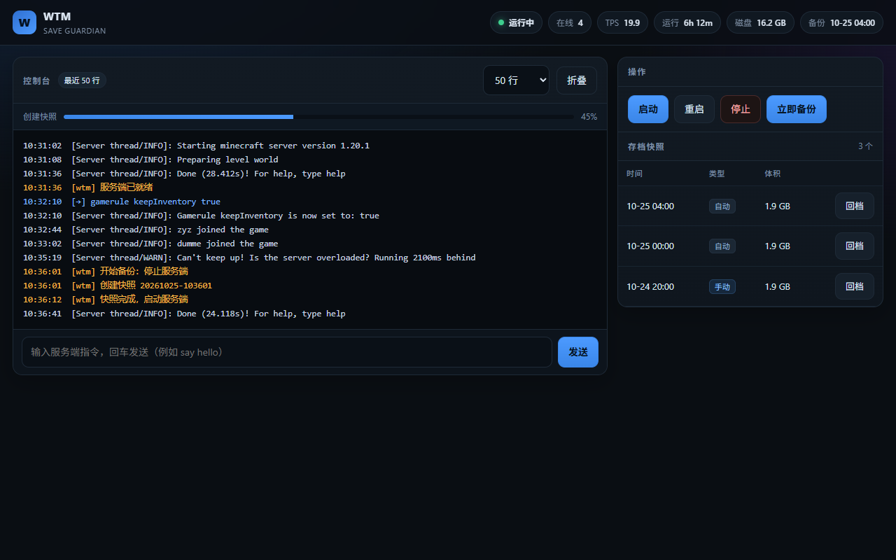

# WTM · Minecraft 存档保险箱

> 给 Minecraft Java 服务器的"存档保险箱"：**停服一致性快照 → 硬链接去重 → 一键回档 → 自动体检**，
> 外加一个极简控制面板。单个 jar，零第三方依赖，不开作弊也能远程管理。



## 它解决什么问题

家庭服/朋友服最常见的两类事故：

1. **熊孩子把家拆了** —— 有备份也不知道怎么回。
2. **手滑 / 插件炸档** —— 备份打出来是坏的，或者根本是一周前的。

WTM 的做法：

- **停服快照**：先 `save-all` + `stop`，世界静止后再复制，不会产生"半个区块"的撕裂档；
- **硬链接去重**：快照之间共享未变更文件，5 GB 世界每次增量通常只有几百 MB；
- **一键回档**：面板点一下，自动先拍 `pre_restore`，回错了还能回回来；
- **恢复后体检**：检查 region 头部、level.dat 魔法数，坏了当场报出来。

## 三条安全约束（改代码前必读）

1. 快照**只在服务端停止时**创建，源文件必须静止。
2. 硬链接**只在快照与快照之间**建立，**永不指向 `world/`**。
3. 恢复必须**复制物化**，不能把快照目录改名成 `world/`。

违反任意一条，在线世界的原地写入会把所有共享 inode 的历史快照一起写坏。

## 功能

| 能力 | 说明 |
|---|---|
| 进程托管 | 拉起/停止 Java 子进程，抓 stdout、转发指令、判断 `Done (` 就绪 |
| 极简面板 | 单页、无前端框架、无 CDN；控制台默认只显示最近 50 行，可折叠 |
| 定时备份 | 每天固定时刻；有玩家在线时等待空服（可配置），超时跳过并提示 |
| 手动备份 | 面板一键，35–45 秒停机（模组服实测） |
| 回档 | 两阶段（pre_restore 快照 → 替换世界 → 启动 → 体检） |
| 存档体检 | region 头 8 KB 校验、扇区越界、level.dat gzip 探测 |
| 安全 | 单口令（PBKDF2）+ HMAC 会话 + CSRF；默认只监听 127.0.0.1 |
| 零依赖 | 仅 JDK 21，`wtm.jar` 约 67 KB |

## 快速开始（Linux VPS）

```bash
# 1. 准备
sudo mkdir -p /opt/wtm/data
sudo cp wtm.jar /opt/wtm/
sudo cp config.example.yaml /opt/wtm/config.yaml

# 2. 生成面板口令
java -jar /opt/wtm/wtm.jar hash-password    # 把输出填进 panel.password_hash

# 3. 安装为服务
sudo cp deploy/wtm.service /etc/systemd/system/
sudo systemctl daemon-reload
sudo systemctl enable --now wtm
```

面板默认只监听 `127.0.0.1:8080`，用 SSH 隧道访问：

```bash
ssh -L 8080:127.0.0.1:8080 user@your-vps
# 浏览器打开 http://127.0.0.1:8080
```

## 配置

见 [`config.example.yaml`](./config.example.yaml)。几个关键项：

| 项 | 说明 |
|---|---|
| `server.dir` | 服务端目录（含 `world/`、`mods/`） |
| `server.args` | 支持 `@argfile`，模组服填 `@libraries/.../unix_args.txt` |
| `server.ready_timeout` | 大整合包首启可能 3–5 分钟，给 `900s` |
| `backup.at` | 自动备份时刻（服务器本地时区） |
| `keep_last` / `keep_daily` | 保留策略；`pre_restore` 永不自动删除 |

> **Windows / Linux 启动参数不同**：NeoForge/Forge 的 `unix_args.txt` 与 `win_args.txt` 分隔符不一样（`:` vs `;`），拿错会直接启动失败。

## 构建

需要 JDK 21：

```bash
./build.sh          # Linux/macOS：编译 + 打包 + 自检
```

```powershell
.\build.ps1 -Jdk "C:\Program Files\Microsoft\jdk-21.0.8.9-hotspot\bin"
```

自检（26 项，不碰真实存档）：

```bash
java -cp wtm.jar wtm.test.SelfTest
```

## 命令

```bash
java -jar wtm.jar run [config.yaml]      # 启动（通常交给 systemd）
java -jar wtm.jar init [config.yaml]     # 生成配置模板
java -jar wtm.jar hash-password          # 生成面板口令哈希
java -jar wtm.jar version
java -cp wtm.jar wtm.test.SelfTest       # 离线自检
```

## 面板

- 顶部状态条：运行状态、在线人数、TPS、运行时长、磁盘余量、上次备份
- 控制台：实时日志（SSE），默认只渲染最近 **50 行**，可切换 200/1000 行或整块折叠
- 操作：启动 / 重启 / 停止 / 立即备份
- 存档快照：时间轴列表 + 回档（需输入 `RESTORE` 确认）
- 设计预览：`http://127.0.0.1:8080/?preview=1` 用假数据渲染界面，便于截图与调样式（不调用任何 API）

## 目录结构

```
src/wtm/
├── Main.java              入口：run / init / hash-password / version
├── app/                   App 装配、任务状态机
├── config/                配置与极简 YAML 解析
├── proc/                  进程托管（起停、环形日志、指令、就绪判定）
├── snap/                  快照引擎、体检
├── web/                   面板、鉴权、HTML 页面
└── test/                  自检 + 冒烟用假服务端
```

## 已知限制

- 只支持单服务器、单实例；不做多节点编排。
- 回档需要停机（这是"不产生撕裂快照"的代价）。
- 体检只到 L1（region 头 + level.dat 魔数），不做全量 NBT 解析与抽样恢复演练。
- 同盘备份防得住误操作，防不住磁盘损坏；后续计划接对象存储。

## License

MIT
